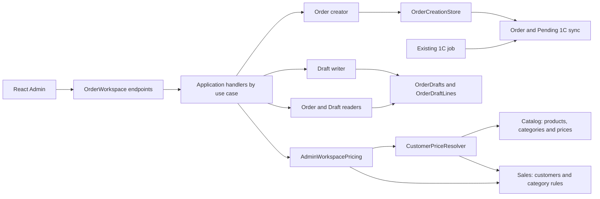

# Admin order workspace

**Module:** Sales. **Consumer:** React Admin (kedr-web `libs/admin/orders/data-access`).

The Minimal API group [OrderWorkspaceEndpoints](../../../../src/Modules/Sales/Sales.Api/Endpoints/OrderWorkspace/OrderWorkspaceEndpoints.cs) exposes separate `/api/admin/order-workspace` routes (tag `AdminOrderWorkspace`, policy `CanManageOrders`); one `<UseCase>Endpoint` per operation dispatches it to its own Application handler. Existing `/api/admin/orders` remains a separate contract. The [order reader](../../../../src/Modules/Sales/Sales.Infrastructure/Orders/Admin/Read/WorkspaceOrderReader.cs) performs search, sorting, and paging; [pricing](../../../../src/Modules/Sales/Sales.Infrastructure/Orders/Admin/Pricing/AdminWorkspacePricing.cs) uses current stock and the customer price from the [price resolver](../../../../src/Modules/Sales/Sales.Infrastructure/Orders/Admin/Pricing/CustomerPriceResolver.cs): the price type of the nearest customer rule on the product's category or any parent category, otherwise the customer's default type. Each line may carry a per-unit `priceAdjustment` in UAH (negative is a discount, positive a markup); the unit price is the customer price plus the adjustment and a discount may not take it below 1 UAH per unit (400 `price_below_minimum`; a product cheaper than 1 UAH cannot be discounted). `POST customer-prices` returns customer prices for up to 100 products without checking stock, so the checkout table shows them even when the quote fails. Orders and drafts store the adjustment per line; the order list returns `adjustmentAmount`, and 1C receives only the final line amounts. Insufficient stock returns the expected 400 `unavailable_product` with product name and quantities.

The line price rules (stock, customer price, the 1 UAH floor, an amount that fits) live in the domain [OrderLinePricing](../../../../src/Modules/Sales/Sales.Domain/Orders/Pricing/OrderLinePricing.cs). Request input is checked by a validator per use case through the shared [input rules](../../../../src/Modules/Sales/Sales.Application/Features/OrderWorkspace/Shared/WorkspaceInputRules.cs); the services return `DomainResult` with the [workspace errors](../../../../src/Modules/Sales/Sales.Application/Features/OrderWorkspace/Shared/WorkspaceErrors.cs) and throw nothing for a business case. Every failure is a `ProblemDetails` answer from the shared mapper with the Ukrainian message in `detail`: a 400 keeps the code of the rule that failed in `code` (`invalid_lines`, `invalid_price_adjustment`, `unavailable_product`, `invalid_date_range`, `invalid_sort` and the others), a 404 says `not_found` and a 409 `conflict`; the checkout 409 comes from [WorkspaceConflictProblem](../../../../src/Modules/Sales/Sales.Api/Endpoints/OrderWorkspace/WorkspaceConflictProblem.cs) with `code` and `quote` at the top level. During checkout, [creator](../../../../src/Modules/Sales/Sales.Infrastructure/Orders/Admin/Checkout/WorkspaceOrderCreator.cs) recalculates the total, compares the fingerprint, and atomically writes Order and Pending 1C sync through the existing OrderCreationStore.

Drafts use a separate [model](../../../../src/Modules/Sales/Sales.Domain/Orders/OrderDraft.cs), [reader](../../../../src/Modules/Sales/Sales.Infrastructure/Orders/Admin/Read/WorkspaceDraftReader.cs), and [write adapter](../../../../src/Modules/Sales/Sales.Infrastructure/Orders/Admin/Drafts/WorkspaceDraftWriter.cs). They do not receive an Order number or go to 1C. The details response contains a current server-side quote or `pricingStatus=Unavailable` with saved lines and `null` for unavailable prices; PUT/DELETE use `If-Match`. Checkout from a draft does not change the draft.

## Structure diagram



## Code structure

```text
src/Modules/Sales/
├── Sales.Api/Endpoints/OrderWorkspace/
│   ├── OrderWorkspaceEndpoints.cs                             # HTTP group (CanManageOrders)
│   ├── <UseCase>Endpoint.cs                                   # one per operation
│   └── WorkspaceConflictProblem.cs                            # checkout 409 → ProblemDetails with code + quote
├── Sales.Application/
│   ├── Abstractions/Orders/
│   │   ├── WorkspaceOrderContracts.cs                         # order DTOs
│   │   ├── WorkspaceDraftContracts.cs                         # draft DTOs
│   │   ├── WorkspaceQuoteContracts.cs                         # quote DTOs
│   │   ├── WorkspacePageContracts.cs                          # paging
│   │   ├── WorkspaceInputLine.cs                              # request line
│   │   ├── IWorkspaceOrderReader.cs                           # order read port
│   │   └── IWorkspaceDraftWriter.cs                           # draft write port
│   └── Features/OrderWorkspace/
│       ├── Shared/
│       │   ├── WorkspaceInputRules.cs                         # shared validator rules with public error codes
│       │   ├── WorkspaceDraftInputValidator.cs                # draft input shared by create and update
│       │   ├── WorkspaceErrors.cs                             # not found, version and idempotency conflicts
│       │   ├── WorkspaceDateRange.cs                          # Kyiv calendar-day filter
│       │   └── WorkspaceSorts.cs                              # allowed list sorts
│       ├── Queries/<UseCase>/<UseCase>{Query,Handler,Validator}.cs
│       │   # GetWorkspaceOrders, GetWorkspaceOrder, QuoteWorkspaceOrder, GetWorkspaceCustomerPrices,
│       │   # GetWorkspaceDrafts, GetWorkspaceDraft, GetWorkspaceOverview
│       └── Commands/<UseCase>/<UseCase>{Command,Handler,Validator}.cs
│           # CreateWorkspaceOrder (checkout), CreateWorkspaceDraft, UpdateWorkspaceDraft, DeleteWorkspaceDraft
├── Sales.Domain/Orders/Entities/OrderDraft.cs                       # persisted draft model
├── Sales.Domain/Orders/Pricing/OrderLinePricing.cs                  # line price rules → DomainResult
└── Sales.Infrastructure/
    ├── Orders/Admin/Read/                                      # order and draft reads
    ├── Orders/Admin/Checkout/WorkspaceOrderCreator.cs          # order checkout
    ├── Orders/Admin/Drafts/WorkspaceDraftWriter.cs             # draft writes
    ├── Orders/Admin/Drafts/WorkspaceDraftDetails.cs            # details projection with fresh prices
    ├── Orders/Admin/Pricing/AdminWorkspacePricing.cs           # quote: stock, adjustments, totals, fingerprint
    ├── Orders/Admin/Pricing/CustomerPriceResolver.cs           # customer price with category inheritance
    ├── Orders/Admin/Idempotency/WorkspaceIdempotency.cs        # hash and DB conflict handling for retries
    ├── Persistence/OrderDrafts/                                # draft table mappings
    ├── Migrations/20261021135819_AddAdminOrderDrafts.cs             # additive table migration
    └── Migrations/20261029130909_AddOrderLinePriceAdjustment.cs     # PriceAdjustment on order and draft lines
```

## Tests

[OrderDraftTests.cs](../../../../tests/UnitTests/Sales/Domain/OrderDraftTests.cs) · [OrderLinePricingTests.cs](../../../../tests/UnitTests/Sales/Domain/OrderLinePricingTests.cs) · [WorkspaceValidatorsTests.cs](../../../../tests/UnitTests/Sales/Application/WorkspaceValidatorsTests.cs) · [WorkspaceDateRangeTests.cs](../../../../tests/UnitTests/Sales/Application/WorkspaceDateRangeTests.cs) · [OrderDraftPostgresTests.cs](../../../../tests/IntegrationTests/Sales/Persistence/OrderDraftPostgresTests.cs) · [WorkspacePricingTests.cs](../../../../tests/IntegrationTests/Sales/Persistence/WorkspacePricingTests.cs) · [WorkspaceOrderAdjustmentPostgresTests.cs](../../../../tests/IntegrationTests/Sales/Persistence/WorkspaceOrderAdjustmentPostgresTests.cs)

The checkout handler has no dedicated test.

Focused run: `dotnet test tests/UnitTests/UnitTests.csproj --filter "FullyQualifiedName~Workspace|FullyQualifiedName~OrderDraft"` and `dotnet test tests/IntegrationTests/IntegrationTests.csproj --filter "FullyQualifiedName~Workspace|FullyQualifiedName~OrderDraft"`.

## Related sources

[Order contract](../../contracts/sales/admin-order-workspace.openapi.yaml) · [Draft contract](../../contracts/sales/admin-order-drafts.openapi.yaml) · [SDD 004](../../specs/sales/004-admin-order-workspace/README.md) · [SDD 005](../../specs/sales/005-admin-order-drafts/README.md) · [SDD 008](../../specs/sales/008-workspace-customer-prices-and-adjustments/README.md).
