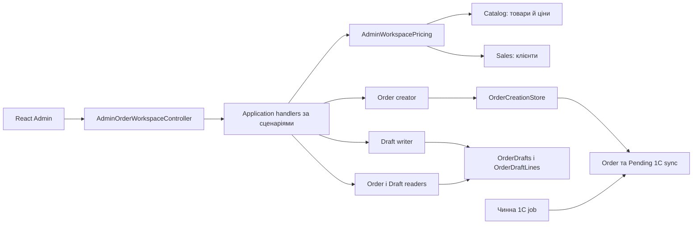

# Робоча область замовлень Admin

**Модуль:** Sales. **Споживач:** React Admin. **Стан:** код і контракт у репозиторії; міграцію не застосовано до робочої БД.

[AdminOrderWorkspaceController](../../../../src/Sales/Sales.Api/Controllers/AdminOrderWorkspaceController.cs) відкриває окремі анонімні маршрути `/api/admin/order-workspace` і передає кожну операцію окремому Application handler. Наявний `/api/admin/orders` залишається окремим контрактом. [Читач замовлень](../../../../src/Sales/Sales.Infrastructure/Orders/Admin/Read/WorkspaceOrderReader.cs) виконує пошук, сортування й сторінковий перегляд; [pricing](../../../../src/Sales/Sales.Infrastructure/Orders/Admin/Pricing/AdminWorkspacePricing.cs) бере політику вибраного клієнта, актуальний залишок та ціни Catalog. Недостатній залишок повертає очікуваний 400 `unavailable_product` із назвою й кількостями товару. Під час оформлення [creator](../../../../src/Sales/Sales.Infrastructure/Orders/Admin/Checkout/WorkspaceOrderCreator.cs) повторно розраховує суму, порівнює fingerprint і через чинний OrderCreationStore атомарно записує Order та Pending 1C sync.

Чернетки реалізовано окремою [моделлю](../../../../src/Sales/Sales.Domain/Orders/Entities/OrderDraft.cs), [читачем](../../../../src/Sales/Sales.Infrastructure/Orders/Admin/Read/WorkspaceDraftReader.cs) і [адаптером запису](../../../../src/Sales/Sales.Infrastructure/Orders/Admin/Drafts/WorkspaceDraftWriter.cs). Вони не отримують номера Order і не передаються в 1C. Відповідь деталі містить актуальний серверний розрахунок або `pricingStatus=Unavailable` зі збереженими позиціями та `null` замість недоступних цін; PUT/DELETE використовують `If-Match`. Оформлення на основі чернетки не змінює її.

## Схема будови



## Структура в коді

```text
src/Sales/
├── Sales.Api/Controllers/AdminOrderWorkspaceController.cs           # анонімний HTTP-вхід, відомі помилки → статус/code/message
├── Sales.Application/
│   ├── Contracts/Orders/
│   │   ├── WorkspaceOrderContracts.cs                         # DTO замовлень
│   │   ├── WorkspaceDraftContracts.cs                         # DTO чернеток
│   │   ├── WorkspaceQuoteContracts.cs                         # DTO розрахунку
│   │   ├── WorkspacePageContracts.cs                          # пагінація
│   │   ├── WorkspaceInputLine.cs                              # позиція запиту
│   │   ├── IWorkspaceOrderReader.cs                           # порт читання замовлень
│   │   └── IWorkspaceDraftWriter.cs                           # порт запису чернеток
│   └── Features/Orders/AdminWorkspace/
│       ├── Orders/GetList/GetWorkspaceOrdersQueryHandler.cs  # список замовлень
│       ├── Orders/Quote/QuoteWorkspaceOrderQueryHandler.cs   # серверний quote
│       ├── Orders/Create/CreateWorkspaceOrderCommandHandler.cs # оформлення
│       ├── Drafts/GetList/GetWorkspaceDraftsQueryHandler.cs  # список чернеток
│       ├── Drafts/Create/CreateWorkspaceDraftCommandHandler.cs # нова чернетка
│       ├── Drafts/Update/UpdateWorkspaceDraftCommandHandler.cs # редагування
│       └── Drafts/Delete/DeleteWorkspaceDraftCommandHandler.cs # видалення
├── Sales.Domain/Orders/Entities/OrderDraft.cs                       # модель збереженої чернетки
└── Sales.Infrastructure/
    ├── Orders/Admin/Read/                                      # читання замовлень і чернеток
    ├── Orders/Admin/Checkout/WorkspaceOrderCreator.cs          # оформлення замовлення
    ├── Orders/Admin/Drafts/WorkspaceDraftWriter.cs             # запис чернеток
    ├── Orders/Admin/Drafts/WorkspaceDraftDetails.cs            # проєкція деталей зі свіжою ціною
    ├── Orders/Admin/Pricing/AdminWorkspacePricing.cs           # серверний розрахунок
    ├── Orders/Admin/Idempotency/WorkspaceIdempotency.cs        # hash і DB conflict для повторів
    └── Migrations/20261021135819_AddAdminOrderDrafts.cs             # адитивна міграція таблиць
```

## Пов'язані джерела

[Контракт замовлень](../../contracts/sales/admin-order-workspace.openapi.yaml) · [Контракт чернеток](../../contracts/sales/admin-order-drafts.openapi.yaml) · [SDD 004](../../specs/sales/004-admin-order-workspace/README.md) · [SDD 005](../../specs/sales/005-admin-order-drafts/README.md).
