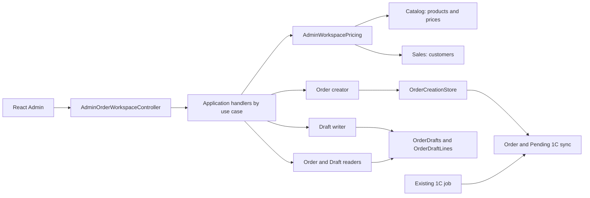

# Admin order workspace

**Module:** Sales. **Consumer:** React Admin (kedr-web `libs/admin/orders/data-access`).

[AdminOrderWorkspaceController](../../../../src/Sales/Sales.Api/Controllers/AdminOrderWorkspaceController.cs) exposes separate `/api/admin/order-workspace` routes (policy `CanManageOrders`) and dispatches each operation to its own Application handler. Existing `/api/admin/orders` remains a separate contract. The [order reader](../../../../src/Sales/Sales.Infrastructure/Orders/Admin/Read/WorkspaceOrderReader.cs) performs search, sorting, and paging; [pricing](../../../../src/Sales/Sales.Infrastructure/Orders/Admin/Pricing/AdminWorkspacePricing.cs) uses the selected customer's policy, current stock, and Catalog prices. Insufficient stock returns the expected 400 `unavailable_product` with product name and quantities. During checkout, [creator](../../../../src/Sales/Sales.Infrastructure/Orders/Admin/Checkout/WorkspaceOrderCreator.cs) recalculates the total, compares the fingerprint, and atomically writes Order and Pending 1C sync through the existing OrderCreationStore.

Drafts use a separate [model](../../../../src/Sales/Sales.Domain/Orders/Entities/OrderDraft.cs), [reader](../../../../src/Sales/Sales.Infrastructure/Orders/Admin/Read/WorkspaceDraftReader.cs), and [write adapter](../../../../src/Sales/Sales.Infrastructure/Orders/Admin/Drafts/WorkspaceDraftWriter.cs). They do not receive an Order number or go to 1C. The details response contains a current server-side quote or `pricingStatus=Unavailable` with saved lines and `null` for unavailable prices; PUT/DELETE use `If-Match`. Checkout from a draft does not change the draft.

## Structure diagram



## Code structure

```text
src/Sales/
├── Sales.Api/Controllers/AdminOrderWorkspaceController.cs           # HTTP entry (CanManageOrders), known errors → status/code/message
├── Sales.Application/
│   ├── Contracts/Orders/
│   │   ├── WorkspaceOrderContracts.cs                         # order DTOs
│   │   ├── WorkspaceDraftContracts.cs                         # draft DTOs
│   │   ├── WorkspaceQuoteContracts.cs                         # quote DTOs
│   │   ├── WorkspacePageContracts.cs                          # paging
│   │   ├── WorkspaceInputLine.cs                              # request line
│   │   ├── IWorkspaceOrderReader.cs                           # order read port
│   │   └── IWorkspaceDraftWriter.cs                           # draft write port
│   └── Features/Orders/AdminWorkspace/
│       ├── Orders/GetList/GetWorkspaceOrdersQueryHandler.cs  # order list
│       ├── Orders/Quote/QuoteWorkspaceOrderQueryHandler.cs   # server-side quote
│       ├── Orders/Create/CreateWorkspaceOrderCommandHandler.cs # checkout
│       ├── Drafts/GetList/GetWorkspaceDraftsQueryHandler.cs  # draft list
│       ├── Drafts/Create/CreateWorkspaceDraftCommandHandler.cs # create draft
│       ├── Drafts/Update/UpdateWorkspaceDraftCommandHandler.cs # edit draft
│       └── Drafts/Delete/DeleteWorkspaceDraftCommandHandler.cs # delete draft
├── Sales.Domain/Orders/Entities/OrderDraft.cs                       # persisted draft model
└── Sales.Infrastructure/
    ├── Orders/Admin/Read/                                      # order and draft reads
    ├── Orders/Admin/Checkout/WorkspaceOrderCreator.cs          # order checkout
    ├── Orders/Admin/Drafts/WorkspaceDraftWriter.cs             # draft writes
    ├── Orders/Admin/Drafts/WorkspaceDraftDetails.cs            # details projection with fresh prices
    ├── Orders/Admin/Pricing/AdminWorkspacePricing.cs           # server-side pricing
    ├── Orders/Admin/Idempotency/WorkspaceIdempotency.cs        # hash and DB conflict handling for retries
    └── Migrations/20261021135819_AddAdminOrderDrafts.cs             # additive table migration
```

## Tests

[OrderDraftTests.cs](../../../../tests/UnitTests/Sales/Domain/OrderDraftTests.cs) · [WorkspaceDateRangeTests.cs](../../../../tests/UnitTests/Sales/Api/WorkspaceDateRangeTests.cs) · [WorkspaceExceptionBehaviorTests.cs](../../../../tests/UnitTests/Sales/Application/WorkspaceExceptionBehaviorTests.cs) · [OrderDraftPostgresTests.cs](../../../../tests/IntegrationTests/Sales/Persistence/OrderDraftPostgresTests.cs)

Quote and checkout handlers have no dedicated tests.

Focused run: `dotnet test tests/UnitTests/UnitTests.csproj --filter "FullyQualifiedName~Workspace|FullyQualifiedName~OrderDraft"` and `dotnet test tests/IntegrationTests/IntegrationTests.csproj --filter "FullyQualifiedName~Workspace|FullyQualifiedName~OrderDraft"`.

## Related sources

[Order contract](../../contracts/sales/admin-order-workspace.openapi.yaml) · [Draft contract](../../contracts/sales/admin-order-drafts.openapi.yaml) · [SDD 004](../../specs/sales/004-admin-order-workspace/README.md) · [SDD 005](../../specs/sales/005-admin-order-drafts/README.md).
