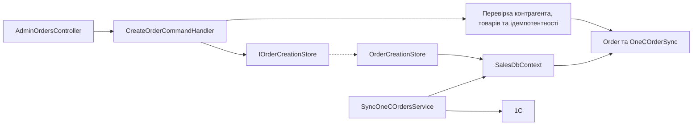

# Замовлення менеджера та 1C

**Статична звірка з кодом:** 2026-10-16. **Модуль:** sales.

Створення, читання, статус синхронізації та retry замовлення.

## Будова й зв'язки

[AdminOrdersController](../../../../src/Sales/Sales.Api/Controllers/AdminOrdersController.cs) викликає [create handler](../../../../src/Sales/Sales.Application/Features/Orders/Create/CreateOrderCommandHandler.cs): перевірка контрагента/товарів, ідемпотентності, запис [Order](../../../../src/Sales/Sales.Domain/Orders/Entities/Order.cs) і [OneCOrderSync](../../../../src/Sales/Sales.Domain/Orders/Entities/OneCOrderSync.cs) через [IOrderCreationStore](../../../../src/Sales/Sales.Application/Contracts/Persistence/IOrderCreationStore.cs) та [OrderCreationStore](../../../../src/Sales/Sales.Infrastructure/Orders/OrderCreationStore.cs). [SyncOneCOrdersService](../../../../src/Sales/Sales.Infrastructure/Integrations/OneC/Services/SyncOneCOrdersService.cs) відповідає за передачу в 1C.

## Структура в коді

Наведено перевірені точки входу та ключові складові фічі; дерево не перелічує всі допоміжні файли.

```text
src/
└── Sales/
    ├── Sales.Api/Controllers/AdminOrdersController.cs  # HTTP-вхід
    ├── Sales.Application/
    │   ├── Contracts/Persistence/IOrderCreationStore.cs  # порт і контракт
    │   └── Features/Orders/
    │       ├── Create/CreateOrderCommandHandler.cs  # обробник сценарію
    │       ├── GetById/GetOrderByIdQueryHandler.cs  # обробник сценарію
    │       ├── GetList/GetOrderListQueryHandler.cs  # обробник сценарію
    │       ├── GetSyncStatus/GetOrderSyncStatusQueryHandler.cs  # обробник сценарію
    │       └── RetrySync/RetryOrderSyncCommandHandler.cs  # обробник сценарію
    ├── Sales.Domain/Orders/Entities/
    │   ├── OneCOrderSync.cs  # доменна модель
    │   └── Order.cs  # доменна модель
    └── Sales.Infrastructure/
        ├── Integrations/OneC/Services/SyncOneCOrdersService.cs  # інфраструктурна реалізація
        └── Orders/OrderCreationStore.cs  # доступ до даних
```

## Схема будови



## Пов'язані джерела

[Створення й sync](../../contracts/sales/admin-order-one-c-sync.openapi.yaml) · [Читання](../../contracts/sales/manager-order-read.openapi.yaml) · [SDD створення](../../specs/sales/001-admin-order-one-c-sync/README.md) · [SDD читання](../../specs/sales/002-manager-order-read-api/README.md).
