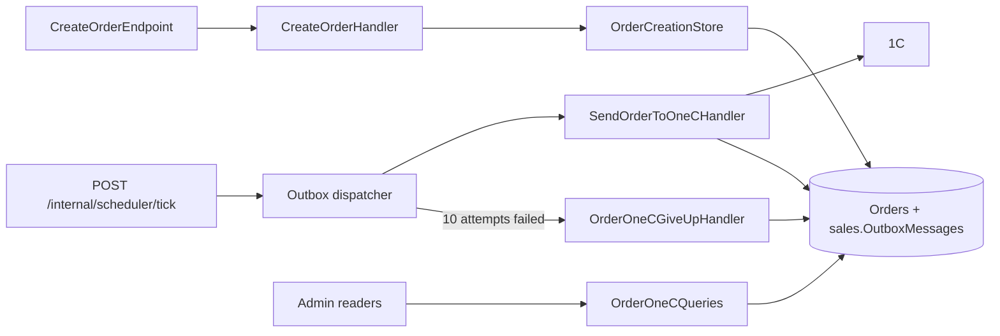

# Manager orders and 1C

**Static code check:** 2026-11-16. **Module:** Sales.

Order creation and reads, the 1C delivery state of every order, and the manual retry.

## Structure and relationships

The Minimal API group [OrdersEndpoints](../../../../src/Modules/Sales/Sales.Api/Endpoints/Orders/OrdersEndpoints.cs) (tag `AdminOrders`, `CanManageOrders`) has one `<UseCase>Endpoint` per use case; [CreateOrderEndpoint](../../../../src/Modules/Sales/Sales.Api/Endpoints/Orders/CreateOrder/CreateOrderEndpoint.cs) invokes the [create handler](../../../../src/Modules/Sales/Sales.Application/Features/Orders/Commands/CreateOrder/CreateOrderHandler.cs), which validates the counterparty/products and idempotency, then [OrderCreationStore](../../../../src/Modules/Sales/Sales.Infrastructure/Orders/OrderCreationStore.cs) saves the [Order](../../../../src/Modules/Sales/Sales.Domain/Orders/Order.cs) and an [OrderPlaced](../../../../src/Modules/Sales/Sales.Application/Features/Orders/OneCDelivery/Messages/OrderPlaced.cs) message in the shared Sales outbox in one transaction ([platform spec 006](../../specs/platform/006-transactional-outbox/README.md), R-008).

The outbox tick sends it: [SendOrderToOneCHandler](../../../../src/Modules/Sales/Sales.Application/Features/Orders/OneCDelivery/Send/SendOrderToOneCHandler.cs) waits for the Kyiv sending window ([OneCSendingWindow](../../../../src/Modules/Sales/Sales.Application/Features/Orders/OneCDelivery/Send/OneCSendingWindow.cs)), writes the order to 1C and stores the answer on the order (`OneCDocumentNumber` or `OneCRejection`). A transport failure is retried by the outbox schedule (1, 5, 15, 30, 60 minutes, then hourly, 10 attempts); after the last one [OrderOneCGiveUpHandler](../../../../src/Modules/Sales/Sales.Application/Features/Orders/OneCDelivery/GiveUp/OrderOneCGiveUpHandler.cs) queues the Telegram alert [OrderOneCDeliveryFailed](../../../../src/Modules/Sales/Sales.Application/Features/Orders/OneCDelivery/Messages/OrderOneCDeliveryFailed.cs).

Every reader takes the 1C state from [OrderOneCQueries](../../../../src/Modules/Sales/Sales.Infrastructure/Orders/OneCDelivery/OrderOneCQueries.cs): the order joined to its outbox row by `Orders.OneCMessageId`, turned into [OrderOneCSync](../../../../src/Modules/Sales/Sales.Application/Abstractions/Orders/Sync/OrderOneCSync.cs) (status, reason, attempts, last and next attempt). The admin list and detail return these as `syncStatus`, `syncError`, `syncAttempts`, `syncLastAttemptAtUtc`, `syncNextAttemptAtUtc`; an order made from a site order also carries `siteOrderId` and `siteOrderNumber` ([site order](quick-order.md), spec sales/009 R-015). The manual retry ([OrderSyncRetryStore](../../../../src/Modules/Sales/Sales.Infrastructure/Orders/OneCDelivery/OrderSyncRetryStore.cs)) puts the same outbox row back in the queue for a `BusinessError` or `DeadLetter` order (and, for a `RetryScheduled` order, «Надіслати зараз» makes the waiting row due now with its attempts kept, platform spec 006 R-015) and writes `OrderSyncRetryAudits`.

## Code structure

The tree lists verified entry points and key components, not every supporting file.

```text
src/Modules/Sales/
├── Sales.Api/Endpoints/Orders/OrdersEndpoints.cs  # HTTP group; one <UseCase>Endpoint.cs per use case
├── Sales.Application/
│   ├── Abstractions/Orders/Sync/OrderOneCSync.cs  # 1C state computed from the order and its message
│   └── Features/Orders/
│       ├── Commands/CreateOrder/CreateOrderHandler.cs  # use-case handler
│       ├── Commands/RetryOrderSync/RetryOrderSyncHandler.cs  # manual retry
│       ├── OneCDelivery/Messages/  # OrderPlaced, OrderOneCDeliveryFailed
│       ├── OneCDelivery/Send/SendOrderToOneCHandler.cs  # outbox handler: window, 1C call, answer on the order
│       ├── OneCDelivery/GiveUp/  # last attempt failed: queue the Telegram alert, send it
│       ├── Queries/GetOrderById/GetOrderByIdHandler.cs  # use-case handler
│       ├── Queries/GetOrderList/GetOrderListHandler.cs  # use-case handler
│       └── Queries/GetOrderSyncStatus/GetOrderSyncStatusHandler.cs  # use-case handler
├── Sales.Domain/Orders/Order.cs  # order with the 1C answer (AcceptByOneC, RejectByOneC, ReopenOneCDelivery)
└── Sales.Infrastructure/Orders/
    ├── OrderCreationStore.cs  # order + outbox message in one transaction
    └── OneCDelivery/  # OrderOneCQueries, delivery store, retry store, status reader
```

## Structure diagram



## Tests

[SalesOrderTests.cs](../../../../tests/UnitTests/Sales/Domain/SalesOrderTests.cs) · [OrderOneCResultTests.cs](../../../../tests/UnitTests/Sales/Domain/OrderOneCResultTests.cs) · [OneCDelivery/](../../../../tests/UnitTests/Sales/Application/Orders/OneCDelivery) · [CreateOrderCommandHandlerTests.cs](../../../../tests/UnitTests/Sales/Application/Orders/CreateOrderCommandHandlerTests.cs) · [GetOrderListQueryHandlerTests.cs](../../../../tests/UnitTests/Sales/Application/Orders/GetOrderListQueryHandlerTests.cs) · [GetOrderByIdQueryHandlerTests.cs](../../../../tests/UnitTests/Sales/Application/Orders/GetOrderByIdQueryHandlerTests.cs) · [RetryOrderSyncCommandHandlerTests.cs](../../../../tests/UnitTests/Sales/Application/Orders/RetryOrderSyncCommandHandlerTests.cs) · [AdminOrderApiTests.cs](../../../../tests/IntegrationTests/Sales/Api/AdminOrderApiTests.cs) · [ManagerOrderReadApiTests.cs](../../../../tests/IntegrationTests/Sales/Api/ManagerOrderReadApiTests.cs) · [OneC/OrderDelivery/](../../../../tests/IntegrationTests/Sales/OneC/OrderDelivery) · [AdminOrderCreationPostgresTests.cs](../../../../tests/IntegrationTests/Sales/Persistence/Orders/AdminOrderCreationPostgresTests.cs) · [SalesOrderPersistenceTests.cs](../../../../tests/IntegrationTests/Sales/Persistence/Orders/SalesOrderPersistenceTests.cs) · [SalesOrderReadModelTests.cs](../../../../tests/IntegrationTests/Sales/Persistence/Orders/SalesOrderReadModelTests.cs)

Focused run: `dotnet test tests/UnitTests/UnitTests.csproj --filter "FullyQualifiedName~Order"` and `dotnet test tests/IntegrationTests/IntegrationTests.csproj --filter "FullyQualifiedName~Order"` (integration tests need PostgreSQL).

## Related sources

[Create and sync contract](../../contracts/openapi.json) · [Read contract](../../contracts/openapi.json) · [Create SDD](../../specs/sales/001-admin-order-one-c-sync/README.md) · [Read SDD](../../specs/sales/002-manager-order-read-api/README.md) · [Outbox SDD](../../specs/platform/006-transactional-outbox/README.md) · [1C runbook](../../operations/jobs/sales-one-c-runbook.md).
