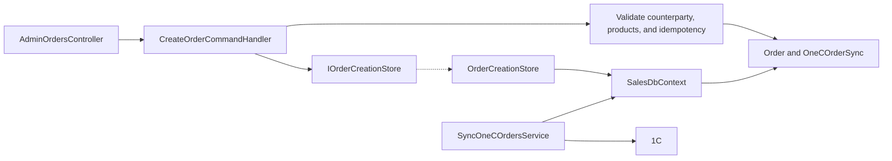

# Manager orders and 1C

**Static code check:** 2026-10-16. **Module:** Sales.

Order creation and reads, synchronization status, and retry.

## Structure and relationships

[AdminOrdersController](../../../../src/Sales/Sales.Api/Controllers/AdminOrdersController.cs) invokes the [create handler](../../../../src/Sales/Sales.Application/Features/Orders/Create/CreateOrderCommandHandler.cs), which validates the counterparty/products and idempotency, then persists [Order](../../../../src/Sales/Sales.Domain/Orders/Entities/Order.cs) and [OneCOrderSync](../../../../src/Sales/Sales.Domain/Orders/Entities/OneCOrderSync.cs) through [IOrderCreationStore](../../../../src/Sales/Sales.Application/Contracts/Persistence/IOrderCreationStore.cs) and [OrderCreationStore](../../../../src/Sales/Sales.Infrastructure/Orders/OrderCreationStore.cs). [SyncOneCOrdersService](../../../../src/Sales/Sales.Infrastructure/Integrations/OneC/Services/SyncOneCOrdersService.cs) sends orders to 1C.

## Code structure

The tree lists verified entry points and key components, not every supporting file.

```text
src/
└── Sales/
    ├── Sales.Api/Controllers/AdminOrdersController.cs  # HTTP entry point
    ├── Sales.Application/
    │   ├── Contracts/Persistence/IOrderCreationStore.cs  # port and contract
    │   └── Features/Orders/
    │       ├── Create/CreateOrderCommandHandler.cs  # use-case handler
    │       ├── GetById/GetOrderByIdQueryHandler.cs  # use-case handler
    │       ├── GetList/GetOrderListQueryHandler.cs  # use-case handler
    │       ├── GetSyncStatus/GetOrderSyncStatusQueryHandler.cs  # use-case handler
    │       └── RetrySync/RetryOrderSyncCommandHandler.cs  # use-case handler
    ├── Sales.Domain/Orders/Entities/
    │   ├── OneCOrderSync.cs  # domain model
    │   └── Order.cs  # domain model
    └── Sales.Infrastructure/
        ├── Integrations/OneC/Services/SyncOneCOrdersService.cs  # infrastructure implementation
        └── Orders/OrderCreationStore.cs  # data access
```

## Structure diagram



## Tests

[SalesOrderTests.cs](../../../../tests/UnitTests/Sales/Domain/SalesOrderTests.cs) · [OneCOrderSyncTests.cs](../../../../tests/UnitTests/Sales/Domain/OneCOrderSyncTests.cs) · [OneCOrderSyncNotificationTests.cs](../../../../tests/UnitTests/Sales/Domain/OneCOrderSyncNotificationTests.cs) · [CreateOrderCommandHandlerTests.cs](../../../../tests/UnitTests/Sales/Application/CreateOrderCommandHandlerTests.cs) · [GetOrderListQueryHandlerTests.cs](../../../../tests/UnitTests/Sales/Application/GetOrderListQueryHandlerTests.cs) · [GetOrderByIdQueryHandlerTests.cs](../../../../tests/UnitTests/Sales/Application/GetOrderByIdQueryHandlerTests.cs) · [RetryOrderSyncCommandHandlerTests.cs](../../../../tests/UnitTests/Sales/Application/RetryOrderSyncCommandHandlerTests.cs) · [AdminOrderApiTests.cs](../../../../tests/IntegrationTests/Sales/Api/AdminOrderApiTests.cs) · [ManagerOrderReadApiTests.cs](../../../../tests/IntegrationTests/Sales/Api/ManagerOrderReadApiTests.cs) · [ManagerOrderReadContractTests.cs](../../../../tests/IntegrationTests/Platform/Api/ManagerOrderReadContractTests.cs) · [OneC/](../../../../tests/IntegrationTests/Sales/OneC) · [AdminOrderCreationPostgresTests.cs](../../../../tests/IntegrationTests/Sales/Persistence/AdminOrderCreationPostgresTests.cs) · [OrderSyncManualRetryPostgresTests.cs](../../../../tests/IntegrationTests/Sales/Persistence/OrderSyncManualRetryPostgresTests.cs) · [SalesOrderPersistenceTests.cs](../../../../tests/IntegrationTests/Sales/Persistence/SalesOrderPersistenceTests.cs) · [SalesOrderReadModelTests.cs](../../../../tests/IntegrationTests/Sales/Persistence/SalesOrderReadModelTests.cs)

Focused run: `dotnet test tests/UnitTests/UnitTests.csproj --filter "FullyQualifiedName~Order"` and `dotnet test tests/IntegrationTests/IntegrationTests.csproj --filter "FullyQualifiedName~Order"`.

## Related sources

[Create and sync contract](../../contracts/sales/admin-order-one-c-sync.openapi.yaml) · [Read contract](../../contracts/sales/manager-order-read.openapi.yaml) · [Create SDD](../../specs/sales/001-admin-order-one-c-sync/README.md) · [Read SDD](../../specs/sales/002-manager-order-read-api/README.md).
