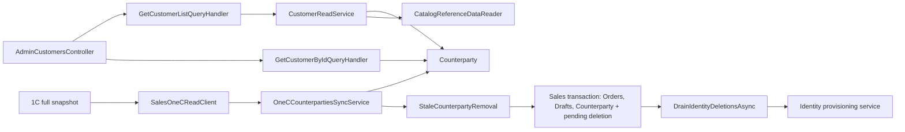

# Клієнти й контрагенти

**Статична звірка з кодом:** 2026-10-22. **Модуль:** sales.

Admin-список і деталі контрагентів, локальна синхронізація з повним списком 1C та відкладене видалення пов'язаних Identity users.

Список `GET /api/admin/customers` застосовує `searchTerm` до ID, імені й телефону та окремі фільтри `counterpartyId`, `name`, `phone` до всієї активної вибірки. Умови поєднуються через AND, `totalRecords` обчислюється до пагінації, а `sort` задає порядок `name`/`counterpartyId`/`phone` у двох напрямках зі стабільним ID. Деталі й синхронізація залишаються окремими сценаріями.

Деталі зберігають ID типів цін і категорій та додають їхні назви з довідників Catalog через пакетний `ICatalogReferenceDataReader`. Відсутній довідниковий запис дає `null` у відповідному полі назви без втрати правила.

За підтвердженим контрактом 1C `GetCounterpartiesAsync` повертає повний список одним масивом. `OneCCounterpartiesSyncService` формує множину джерельних ID до валідації та Identity provisioning; присутній, але пропущений рядок не стає застарілим клієнтом. Порожній масив або будь-який рядок без ID зупиняє видалення для цього проходу.

`StaleCounterpartyRemoval` транзакційно видаляє локальні Order/Draft залежності та записує pending Identity deletion. `DrainIdentityDeletionsAsync` повторює Identity delete на наступному проході; якщо user пов'язаний із чинним Counterparty, його не видаляє. PostgreSQL rollback і concurrency сценарії цього потоку ще не підтверджені спеціалізованими integration tests.

## Будова й зв'язки

[AdminCustomersController](../../../../src/Sales/Sales.Api/Controllers/AdminCustomersController.cs) читає через [list handler](../../../../src/Sales/Sales.Application/Features/Customers/GetList/GetCustomerListQueryHandler.cs) і [detail handler](../../../../src/Sales/Sales.Application/Features/Customers/GetById/GetCustomerByIdQueryHandler.cs). [Counterparty](../../../../src/Sales/Sales.Domain/Customers/Entities/Counterparty.cs) є доменною моделлю; [sync service](../../../../src/Sales/Sales.Infrastructure/Integrations/OneC/Services/OneCCounterpartiesSyncService.cs) оновлює її з 1C, а [stale removal](../../../../src/Sales/Sales.Infrastructure/Integrations/OneC/Services/StaleCounterpartyRemoval.cs) атомарно очищає Sales залежності й планує Identity deletion.

## Структура в коді

Наведено перевірені точки входу та ключові складові фічі; дерево не перелічує всі допоміжні файли.

```text
src/
├── Sales/
│   ├── Sales.Api/Controllers/AdminCustomersController.cs  # HTTP-вхід і query-параметри
│   ├── Sales.Application/Features/Customers/
│   │   ├── GetById/GetCustomerByIdQueryHandler.cs  # обробник сценарію
│   │   └── GetList/GetCustomerListQueryHandler.cs  # обробник сценарію
│   ├── Sales.Domain/Customers/Entities/Counterparty.cs  # доменна модель
│   └── Sales.Infrastructure/
│       ├── Customers/CustomerReadService.cs  # пошук, фільтри, порядок, підрахунок і сторінка
│       ├── Integrations/OneC/SalesOneCReadClient.cs  # повний масив 1C → Sales DTO
│       ├── Integrations/OneC/Services/OneCCounterpartiesSyncService.cs  # source ID set і upsert
│       ├── Integrations/OneC/Services/StaleCounterpartyRemoval.cs  # транзакційне видалення та outbox drain
│       ├── DataBase/Entities/PendingCounterpartyIdentityDeletion.cs  # збережений Identity retry state
│       ├── Configurations/PendingCounterpartyIdentityDeletionConfiguration.cs  # мапінг outbox
│       └── Migrations/20261022103423_AddPendingCounterpartyIdentityDeletions.cs  # таблиця outbox
└── Identity/
    └── Identity.Infrastructure/Services/ImportedCounterpartyIdentityProvisioningService.cs  # Identity lifecycle
```

## Схема будови



## Пов'язані джерела

[Контракт](../../contracts/sales/customer-read.openapi.yaml) · [SDD читання клієнтів](../../specs/sales/003-customer-read-api/README.md) · [SDD звіряння 1C](../../specs/sales/007-customer-sync-reconciliation/README.md) · [Runbook](../../operations/jobs/sales-one-c-runbook.md).
