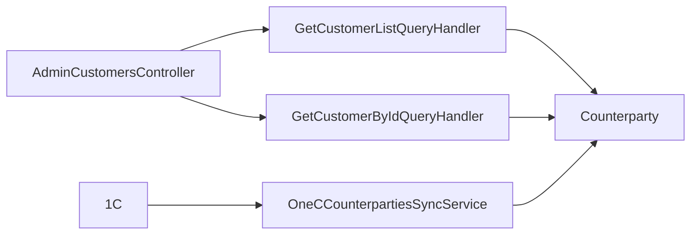

# Клієнти й контрагенти

**Статична звірка з кодом:** 2026-10-16. **Модуль:** sales.

Admin-список і деталі контрагентів, локальна синхронізація з 1C.

## Будова й зв'язки

[AdminCustomersController](../../../../src/Sales/Sales.Api/Controllers/AdminCustomersController.cs) читає через [list handler](../../../../src/Sales/Sales.Application/Features/Customers/GetList/GetCustomerListQueryHandler.cs) і [detail handler](../../../../src/Sales/Sales.Application/Features/Customers/GetById/GetCustomerByIdQueryHandler.cs). [Counterparty](../../../../src/Sales/Sales.Domain/Customers/Entities/Counterparty.cs) є доменною моделлю; [sync service](../../../../src/Sales/Sales.Infrastructure/Integrations/OneC/Services/OneCCounterpartiesSyncService.cs) оновлює її з 1C.

## Структура в коді

Наведено перевірені точки входу та ключові складові фічі; дерево не перелічує всі допоміжні файли.

```text
src/
└── Sales/
    ├── Sales.Api/Controllers/AdminCustomersController.cs  # HTTP-вхід
    ├── Sales.Application/Features/Customers/
    │   ├── GetById/GetCustomerByIdQueryHandler.cs  # обробник сценарію
    │   └── GetList/GetCustomerListQueryHandler.cs  # обробник сценарію
    ├── Sales.Domain/Customers/Entities/Counterparty.cs  # доменна модель
    └── Sales.Infrastructure/Integrations/OneC/Services/OneCCounterpartiesSyncService.cs  # інфраструктурна реалізація
```

## Схема будови



## Пов'язані джерела

[Контракт](../../contracts/sales/customer-read.openapi.yaml) · [SDD](../../specs/sales/003-customer-read-api/README.md) · [Runbook](../../operations/jobs/sales-one-c-runbook.md).
