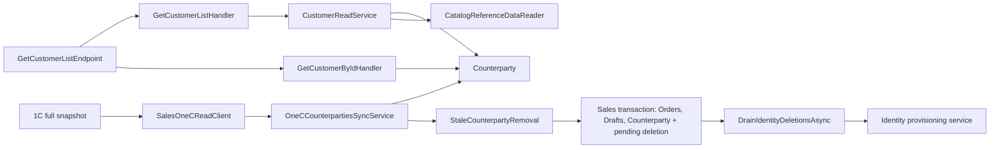

# Customers and counterparties

**Static code check:** 2026-10-22. **Module:** Sales.

Admin counterparty list and details, local synchronization with the full 1C list, and deferred deletion of linked Identity users.

`GET /api/admin/customers` applies `searchTerm` to ID, name, and phone, and applies separate `counterpartyId`, `name`, and `phone` filters to the complete active set. Conditions are combined with AND; `totalRecords` is calculated before paging; `sort` orders by `name`/`counterpartyId`/`phone` in either direction with stable ID as a tie-breaker. Details and synchronization remain separate use cases.

Details retain price type and category IDs and add their Catalog lookup names through batched `ICatalogReferenceDataReader`. If a lookup record is missing, its name field is `null`; the rule is retained.

Under the confirmed 1C contract, `GetCounterpartiesAsync` returns the complete list in one array. `OneCCounterpartiesSyncService` builds the set of source IDs before validation and Identity provisioning; a present but skipped row is not treated as stale. An empty array or any row without an ID stops deletion for that pass.

`StaleCounterpartyRemoval` transactionally deletes local Order/Draft dependencies and records pending Identity deletion. `DrainIdentityDeletionsAsync` retries Identity deletion on the next pass; it does not delete a user linked to a current Counterparty. PostgreSQL rollback and concurrency scenarios for this flow are not yet confirmed by specialized integration tests.

## Structure and relationships

The Minimal API group [CustomersEndpoints](../../../../src/Modules/Sales/Sales.Api/Endpoints/Customers/CustomersEndpoints.cs) (tag `AdminCustomers`, `CanManageOrders`) reads through the [list handler](../../../../src/Modules/Sales/Sales.Application/Features/Customers/Queries/GetCustomerList/GetCustomerListHandler.cs) and [details handler](../../../../src/Modules/Sales/Sales.Application/Features/Customers/Queries/GetCustomerById/GetCustomerByIdHandler.cs). [Counterparty](../../../../src/Modules/Sales/Sales.Domain/Customers/Counterparty.cs) is the domain model; the [sync service](../../../../src/Modules/Sales/Sales.Infrastructure/Integrations/OneC/Counterparties/OneCCounterpartiesSyncService.cs) updates it from 1C, and [stale removal](../../../../src/Modules/Sales/Sales.Infrastructure/Integrations/OneC/Counterparties/StaleCounterpartyRemoval.cs) atomically clears Sales dependencies and schedules Identity deletion.

## Code structure

The tree lists verified entry points and key components; it does not include every supporting file.

```text
src/
├── Modules/Sales/
│   ├── Sales.Api/Endpoints/Customers/                       # HTTP group, one endpoint per use case, query parameters
│   ├── Sales.Application/Features/Customers/Queries/
│   │   ├── GetCustomerById/GetCustomerByIdHandler.cs  # use-case handler
│   │   └── GetCustomerList/GetCustomerListHandler.cs  # use-case handler
│   ├── Sales.Domain/Customers/Entities/Counterparty.cs  # domain model
│   └── Sales.Infrastructure/
│       ├── Customers/CustomerReadService.cs  # search, filters, ordering, count, and paging
│       ├── Integrations/OneC/SalesOneCReadClient.cs  # full 1C array → Sales DTO
│       ├── Integrations/OneC/OneCCounterpartiesSyncService.cs  # source ID set and upsert
│       ├── Integrations/OneC/StaleCounterpartyRemoval.cs  # transactional deletion and outbox drain
│       ├── Persistence/Entities/PendingCounterpartyIdentityDeletion.cs  # persisted Identity retry state
│       ├── Persistence/Customers/PendingCounterpartyIdentityDeletionConfiguration.cs  # outbox mapping
│       └── Migrations/20261022103423_AddPendingCounterpartyIdentityDeletions.cs  # outbox table
└── Modules/Identity/
    └── Identity.Infrastructure/Users/ImportedCounterpartyIdentityProvisioningService.cs  # Identity lifecycle
```

## Structure diagram



## Tests

[GetCustomerListQueryHandlerTests.cs](../../../../tests/UnitTests/Sales/Application/Customers/GetCustomerListQueryHandlerTests.cs) · [GetCustomerByIdQueryHandlerTests.cs](../../../../tests/UnitTests/Sales/Application/Customers/GetCustomerByIdQueryHandlerTests.cs) · [AdminCustomerApiTests.cs](../../../../tests/IntegrationTests/Sales/Api/AdminCustomerApiTests.cs) · [CustomerReadContractTests.cs](../../../../tests/IntegrationTests/Platform/Api/CustomerReadContractTests.cs) · [CounterpartyReconciliationPostgresTests.cs](../../../../tests/IntegrationTests/Sales/Persistence/Customers/CounterpartyReconciliationPostgresTests.cs) · [SalesCustomerReadModelTests.cs](../../../../tests/IntegrationTests/Sales/Persistence/Customers/SalesCustomerReadModelTests.cs) · [SalesCustomerReferenceNamesTests.cs](../../../../tests/IntegrationTests/Sales/Persistence/Customers/SalesCustomerReferenceNamesTests.cs)

Focused run: `dotnet test tests/UnitTests/UnitTests.csproj --filter "FullyQualifiedName~Customer|FullyQualifiedName~Counterparty"` and `dotnet test tests/IntegrationTests/IntegrationTests.csproj --filter "FullyQualifiedName~Customer|FullyQualifiedName~Counterparty"`.

## Related sources

[Contract](../../contracts/sales/customer-read.openapi.yaml) · [Customer read SDD](../../specs/sales/003-customer-read-api/README.md) · [1C reconciliation SDD](../../specs/sales/007-customer-sync-reconciliation/README.md) · [Runbook](../../operations/jobs/sales-one-c-runbook.md).
