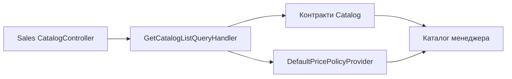

# Каталог менеджера

**Статична звірка з кодом:** 2026-10-16. **Модуль:** sales.

Авторизований список товарів для продажів.

## Будова й зв'язки

[Sales CatalogController](../../../../src/Sales/Sales.Api/Controllers/CatalogController.cs) обслуговує `GET /api/sales/{lang}/catalog/products`; [handler](../../../../src/Sales/Sales.Application/Features/Catalog/GetList/GetCatalogListQueryHandler.cs) формує read-результат через контракти Catalog. [Price policy](../../../../src/Sales/Sales.Infrastructure/Pricing/DefaultPricePolicyProvider.cs) належить Sales. Це інший сценарій, ніж анонімний публічний каталог.

## Структура в коді

Наведено перевірені точки входу та ключові складові фічі; дерево не перелічує всі допоміжні файли.

```text
src/
└── Sales/
    ├── Sales.Api/Controllers/CatalogController.cs  # HTTP-вхід
    ├── Sales.Application/Features/Catalog/GetList/GetCatalogListQueryHandler.cs  # обробник сценарію
    └── Sales.Infrastructure/Pricing/DefaultPricePolicyProvider.cs  # інфраструктурна реалізація
```

## Схема будови



## Пов'язані джерела

[Контракт](../../contracts/sales/catalog.openapi.yaml) · [Публічний каталог](../catalog/public-products.md).
