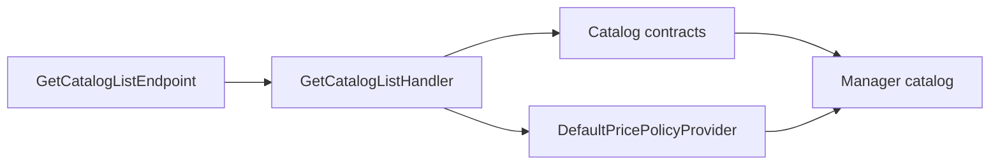

# Manager catalog

**Static code check:** 2026-10-16. **Module:** Sales.

Authorized product list for sales.

## Structure and relationships

[GetCatalogListEndpoint](../../../../src/Modules/Sales/Sales.Api/Endpoints/Catalog/GetCatalogList/GetCatalogListEndpoint.cs) in the [Catalog group](../../../../src/Modules/Sales/Sales.Api/Endpoints/Catalog/CatalogEndpoints.cs) serves `GET /api/sales/{lang}/catalog/products`; the [handler](../../../../src/Modules/Sales/Sales.Application/Features/Catalog/Queries/GetCatalogList/GetCatalogListHandler.cs) builds a read result through Catalog contracts. [Price policy](../../../../src/Modules/Sales/Sales.Infrastructure/Pricing/DefaultPricePolicyProvider.cs) belongs to Sales. This is a separate use case from the anonymous public catalog.

## Code structure

The tree lists verified entry points and key components, not every supporting file.

```text
src/
└── Sales/
    ├── Sales.Api/Endpoints/Catalog/GetCatalogListEndpoint.cs  # HTTP entry point
    ├── Sales.Application/Features/Catalog/Queries/GetCatalogList/GetCatalogListHandler.cs  # use-case handler
    └── Sales.Infrastructure/Pricing/DefaultPricePolicyProvider.cs  # infrastructure implementation
```

## Structure diagram



## Tests

No dedicated automated tests yet.

## Related sources

[Contract](../../contracts/sales/catalog.openapi.yaml) · [Public catalog](../catalog/public-products.md).
