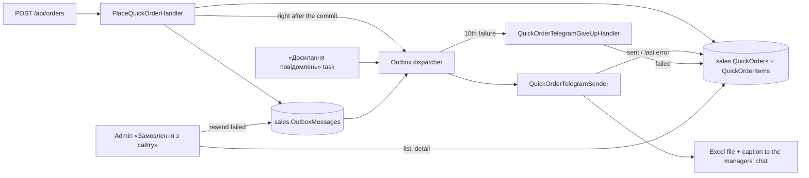

# Site quick order and «Замовлення з сайту»

**Static code check:** 2026-11-24. **Module:** Sales. **Specs:** [sales 009 — site orders in the Admin](../../specs/sales/009-site-orders-in-admin/README.md), [platform 006, R-007](../../specs/platform/006-transactional-outbox/README.md).

Public `POST /api/orders`: a buyer without an account sends a name, a phone and cart lines. The order is kept in `sales."QuickOrders"` together with a Telegram outbox message in one save, and sent to the managers' Telegram chat as an Excel file. Anonymous, rate-limited (`QuickOrder`: 60 per 10 minutes per calling address). The Admin page «Замовлення з сайту» lists the orders, opens one, shows when Telegram has not got it and why, and sends a failed one again.

## Structure and relationships

**Place.** [QuickOrdersEndpoints](../../../../src/Modules/Sales/Sales.Api/Endpoints/QuickOrders/QuickOrdersEndpoints.cs) maps the request to `PlaceQuickOrderCommand`. [PlaceQuickOrderValidator](../../../../src/Modules/Sales/Sales.Application/Features/QuickOrders/Commands/PlaceQuickOrder/PlaceQuickOrderValidator.cs) checks it (400 with field errors `FirstName`, `Phone`, `Lines`; name ≤ 30, phone ≤ 20, product id ≤ 64, title ≤ 500, price ≥ 0, quantity 1–1000). [PlaceQuickOrderHandler](../../../../src/Modules/Sales/Sales.Application/Features/QuickOrders/Commands/PlaceQuickOrder/PlaceQuickOrderHandler.cs) builds the [QuickOrder](../../../../src/Modules/Sales/Sales.Domain/QuickOrders/QuickOrder.cs) aggregate (root; lines `QuickOrderItem` change only through it; `Total` = Σ unit price × quantity) and saves it with its `QuickOrderPlaced` message through [QuickOrderStore](../../../../src/Modules/Sales/Sales.Infrastructure/Persistence/QuickOrders/QuickOrderStore.cs). Once the input is valid, the save and the attempt after it ignore the request's cancellation token: a buyer, the site or the proxy that stops waiting cannot cancel a valid order (spec 009, R-002).

**Telegram delivery.** [QuickOrderTelegramSender](../../../../src/Modules/Sales/Sales.Infrastructure/QuickOrders/QuickOrderTelegramSender.cs) sends the file and records on the order `TelegramSentAtUtc`, or `TelegramLastError` and `TelegramLastAttemptAtUtc` after a failed attempt (for example «Forbidden: bot was kicked from the group chat»). The outbox retries 1, 5, 15, 30 minutes, then hourly, ten attempts in all (about 7 hours); after the tenth [QuickOrderTelegramGiveUpHandler](../../../../src/Modules/Sales/Sales.Application/Features/QuickOrders/Messages/QuickOrderTelegramGiveUpHandler.cs) sets `TelegramFailedAtUtc`. No Telegram alert is sent for a given-up quick order: the same broken chat would swallow it; the Admin list is the signal. Retries run in the scheduled «Досилання повідомлень» task, which must be on in «Фонові задачі».

**Admin.** Group `api/admin/quick-orders` (tag `AdminQuickOrders`, policy `CanManageOrders`):

| Endpoint | operationId | What it does | Rate limit |
| --- | --- | --- | --- |
| `GET /api/admin/quick-orders?page&pageSize&search&delivery` | `getAdminQuickOrders` | Page newest first; `search` matches every word against name or phone; `delivery=problem` keeps orders not delivered with an error or given up | global |
| `GET /api/admin/quick-orders/{orderId}` | `getAdminQuickOrderById` | Buyer, lines with amounts, total, delivery state; 404 when unknown | global |
| `POST /api/admin/quick-orders/{orderId}/telegram-resend` | `resendAdminQuickOrderToTelegram` | Only a `failed` order: puts its outbox message back in the queue with attempts from zero (`OutboxWriter.RequeueAsync`) and clears the failure in one transaction, 202; `sent` → 409 `already_sent`, still retrying → 409 `delivery_in_progress`; a parallel resend loses on `xmin` → 409 | `HeavyOperation` |

`telegramStatus` on the wire is `sent`, `pending` or `failed`. Reads go through [QuickOrderReadService](../../../../src/Modules/Sales/Sales.Infrastructure/Persistence/QuickOrders/QuickOrderReadService.cs) as `AsNoTracking` projections paged in SQL, never through the aggregate.

**Repeats ([idempotency rules](../../standards/idempotency-rules.md)).** The site sends an optional `Idempotency-Key` made once per order attempt and reuses it when it sends the same order again (a second press, a retry after a timeout). The key becomes the order id and the outbox message id, so both primary keys reject a second copy: a repeat, also one that loses the race, answers 200 with the first order id and sends nothing to Telegram again; the same key with other data answers 409 (problem `conflict`, detail «Це замовлення вже надіслано з іншими даними. Оновіть сторінку.»). Repeats are recognised for as long as the order is kept. Without the header every request is a new order. The resend is a state transition: only `failed` can be resent.

**Data.** Tables `QuickOrders` and `QuickOrderItems` in schema `sales` ([data map](../../architecture/data-model/sales-orders.md#site-orders)). Name and phone are personal data: kept with the order like Sales orders, never written to logs (log lines carry the order id, line count, total, and for a resend the staff user id). Processed outbox rows are still deleted after 30 days; the order stays. Migration `AddQuickOrders` copied the orders that existed only in the outbox at release.

The quick order is not a Sales [Order](../../../../src/Modules/Sales/Sales.Domain/Orders/Order.cs) and is not sent to 1C; managers work it from the Excel file and the Admin page.

## Code structure

```text
src/Modules/Sales/
├── Sales.Domain/QuickOrders/                             # QuickOrder (root), QuickOrderItem, ids, QuickOrderTelegramStatus, QuickOrderErrors (six files, flat)
├── Sales.Application/Abstractions/QuickOrders/           # IQuickOrderStore (write), IQuickOrderReadService (read)
├── Sales.Application/Features/QuickOrders/
│   ├── Commands/PlaceQuickOrder/                         # command, validator, handler
│   ├── Commands/ResendQuickOrderToTelegram/              # command, validator, handler, result
│   ├── Queries/GetQuickOrderList/ and GetQuickOrderById/ # queries, validators, handlers, DTOs
│   └── Messages/                                         # QuickOrderPlaced (outbox type "sales.quick-order-placed"), QuickOrderLine, its give-up handler
├── Sales.Infrastructure/Persistence/QuickOrders/         # EF configurations, store, read service
├── Sales.Infrastructure/QuickOrders/                     # Excel file, Telegram caption and sender
└── Sales.Api/Endpoints/QuickOrders/                      # route groups; PlaceQuickOrder/, GetQuickOrderList/, GetQuickOrderById/, ResendQuickOrderToTelegram/
```

## Structure diagram



## Tests

- [QuickOrderTests](../../../../tests/UnitTests/Sales/QuickOrders/QuickOrderTests.cs): factory errors, trimmed buyer, total, delivery state transitions, resend only after give-up, repeat comparison.
- [PlaceQuickOrderRepeatTests](../../../../tests/UnitTests/Sales/QuickOrders/PlaceQuickOrderRepeatTests.cs): the key is the order id, the order and its message are saved together, a cancelled request still saves and sends, a repeat returns the id without saving or sending, other data is a conflict, the loser of a race answers with the winner.
- [ResendQuickOrderToTelegramTests](../../../../tests/UnitTests/Sales/QuickOrders/ResendQuickOrderToTelegramTests.cs): failed → queued once, sent → 409, unknown → 404, a lost row version → 409.
- [QuickOrderTelegramCaptionTests](../../../../tests/UnitTests/Sales/QuickOrders/QuickOrderTelegramCaptionTests.cs): HTML escaping, order id, Kyiv time, file name.
- [QuickOrderApiTests](../../../../tests/IntegrationTests/Sales/QuickOrders/QuickOrderApiTests.cs): sent at once while Telegram works, stored and sent by the next dispatch while it is down, 400 and no row for invalid input, repeats and parallel copies store one order, the same key with other lines answers 409.
- [QuickOrderAdminApiTests](../../../../tests/IntegrationTests/Sales/QuickOrders/QuickOrderAdminApiTests.cs): the real sender over a fake Telegram API — sent order listed with lines; a refused order shows the reason, becomes `failed` after ten attempts, is resent once and then delivered; search by name and phone; 404 and 400; 401/403 without the orders policy.
- Filter `FullyQualifiedName~QuickOrder` (unit and integration).

## Related sources

[Contract](../../contracts/openapi.json) · [Outbox](../../architecture/platform/building-blocks/infrastructure.md) · [Sales orders](admin-orders.md) · [rate limits](../../standards/rate-limit-rules.md).
