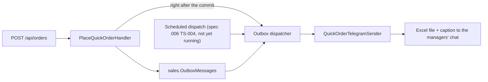

# Site quick order

**Static code check:** 2026-11-14. **Module:** Sales. **Spec:** [platform 006, R-007](../../specs/platform/006-transactional-outbox/README.md).

Public `POST /api/orders`: a buyer without an account sends a name, a phone and cart lines. The order is stored as an outbox message and sent to the managers' Telegram chat as an Excel file. Anonymous, rate-limited (`QuickOrder`: 60 per 10 minutes per calling address).

## Structure and relationships

[QuickOrdersEndpoints](../../../../src/Modules/Sales/Sales.Api/Endpoints/QuickOrders/QuickOrdersEndpoints.cs) maps the request to `PlaceQuickOrderCommand`. [PlaceQuickOrderValidator](../../../../src/Modules/Sales/Sales.Application/Features/QuickOrders/Commands/PlaceQuickOrder/PlaceQuickOrderValidator.cs) checks it (400 with field errors `FirstName`, `Phone`, `Lines`). [PlaceQuickOrderHandler](../../../../src/Modules/Sales/Sales.Application/Features/QuickOrders/Commands/PlaceQuickOrder/PlaceQuickOrderHandler.cs) saves a `QuickOrderPlaced` message in `sales."OutboxMessages"` and tries to send it once after the commit. The buyer gets 200 with the order id even when Telegram is down: the row waits for the next outbox dispatch, which retries it (1, 5, 15, 30, 60 minutes, then hourly; failed after 10 attempts). Until the scheduled dispatch runs (spec 006, TS-004), a failed row waits in the table.

The quick order is not a Sales [Order](../../../../src/Modules/Sales/Sales.Domain/Orders/Order.cs) and is not sent to 1C; managers work it from the Excel file. Processed rows, with the phone number, are deleted after 30 days.

## Code structure

```text
src/Modules/Sales/
├── Sales.Api/Endpoints/QuickOrders/                      # route, tag Order, request/response records (OpenAPI names)
├── Sales.Application/Features/QuickOrders/
│   ├── Commands/PlaceQuickOrder/                         # command, validator, handler
│   └── Messages/                                         # QuickOrderPlaced (outbox type "sales.quick-order-placed"), QuickOrderLine
├── Sales.Application/Abstractions/QuickOrders/IQuickOrderStore.cs
└── Sales.Infrastructure/QuickOrders/                     # store (outbox write), Excel file, Telegram caption and sender
```

## Structure diagram



## Tests

- [QuickOrderApiTests](../../../../tests/IntegrationTests/Sales/QuickOrders/QuickOrderApiTests.cs): sent at once while Telegram works, stored and sent by the next dispatch while it is down, 400 and no row for invalid input. Filter `FullyQualifiedName~QuickOrder`.
- [QuickOrderTelegramCaptionTests](../../../../tests/UnitTests/Sales/QuickOrders/QuickOrderTelegramCaptionTests.cs): HTML escaping, order id, Kyiv time, file name.
- [OpenApiSnapshotTests](../../../../tests/IntegrationTests/Platform/Api/OpenApiSnapshotTests.cs): the contract did not change when the order moved from Catalog.

## Related sources

[Contract](../../contracts/sales/quick-orders.openapi.yaml) · [Outbox](../../architecture/platform/building-blocks/infrastructure.md) · [Sales orders](admin-orders.md).
