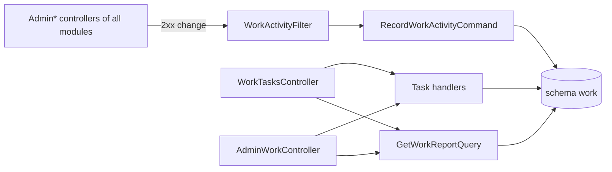

# Staff tasks and the activity log

**Static code check:** 2026-11-06. **Module:** Work. **Spec:** [work/001](../../specs/work/001-staff-tasks-and-activity/README.md).

Every staff member (Manager, Seo, Admin) keeps an own board «Мої задачі» with the columns «План», «В роботі», «Готово» and writes what was done when a task is finished. An administrator can put a task on anybody's board and reads a person's report for a period: finished tasks with their results, open tasks, and what the person changed in the admin. The change list is written automatically, so nobody fills it in.

## Structure and relationships

[WorkTasksController](../../../../src/Work/Work.Api/Controllers/WorkTasksController.cs) (`/api/work`, `RequireManagerRole`) works only with the caller's own tasks: [OwnWorkTask](../../../../src/Work/Work.Application/Features/Tasks/Common/OwnWorkTask.cs) answers `404` for another person's task. [AdminWorkController](../../../../src/Work/Work.Api/Controllers/AdminWorkController.cs) (`/api/admin/work`, `RequireAdminRole`) creates a task for a user and reads anybody's report. [WorkTask](../../../../src/Work/Work.Domain/Tasks/WorkTask.cs) keeps the state rules (start time once, result only while done).

[WorkActivityFilter](../../../../src/Work/Work.Api/Activity/WorkActivityFilter.cs) is a global MVC result filter registered in [ControllersRegistrationExtensions](../../../../src/Bootstrapper/Host.Api/DependencyInjection/ServiceRegistration/Web/ControllersRegistrationExtensions.cs). After a staff member's `2xx` answer to `POST`, `PUT`, `PATCH` or `DELETE` on any `Admin*` controller of another module, it sends [RecordWorkActivityCommand](../../../../src/Work/Work.Application/Features/Activity/Record/RecordWorkActivityCommand.cs) with the area (`Categories`), operation (`UpdateContent`), method, and route values (`id=12, lang=uk`). The handler merges a repeat of the same change within 10 minutes into the last entry ([WorkActivity](../../../../src/Work/Work.Domain/Activity/WorkActivity.cs)). Other modules do not know about Work; a failed write is only logged.

[GetWorkReportQueryHandler](../../../../src/Work/Work.Application/Features/Report/GetReport/GetWorkReportQueryHandler.cs) counts Kyiv calendar days (period ≤ 92 days) and returns at most 2000 activity entries. Users are stored as Identity user IDs without a foreign key; the admin shows names from the users list.

## Code structure

```text
src/Work/
├── Work.Api/
│   ├── Controllers/WorkTasksController.cs   # /api/work/tasks, /api/work/report (own)
│   ├── Controllers/AdminWorkController.cs   # /api/admin/work/tasks, /api/admin/work/report
│   ├── Activity/WorkActivityFilter.cs       # writes the activity log after admin changes
│   └── Requests/WorkRequests.cs
├── Work.Application/
│   ├── Features/Tasks/                      # GetMine, Create, Update, ChangeStatus, Delete, CreateForUser
│   ├── Features/Activity/Record/            # RecordWorkActivityCommand (filter only)
│   └── Features/Report/GetReport/           # report for a user and a period
├── Work.Domain/                             # WorkTask, WorkActivity, errors
└── Work.Infrastructure/
    ├── DataBase/WorkDbContext.cs            # schema work, own migration history
    └── Migrations/*_InitialWork.cs
```

## Structure diagram



## Data

[Work: tasks and activity](../../architecture/data-model/work-tasks.md). Contract: [work.openapi.yaml](../../contracts/work/work.openapi.yaml).

## Tests

- Unit: [WorkTaskTests](../../../../tests/UnitTests/Work/WorkTaskTests.cs), [WorkActivityTests](../../../../tests/UnitTests/Work/WorkActivityTests.cs), [WorkValidatorTests](../../../../tests/UnitTests/Work/WorkValidatorTests.cs) — `dotnet test tests/UnitTests/UnitTests.csproj --filter "FullyQualifiedName~UnitTests.Work"`.
- API: [WorkApiTests](../../../../tests/IntegrationTests/Work/WorkApiTests.cs) (in-memory, no Docker) — `dotnet test tests/IntegrationTests/IntegrationTests.csproj --filter "FullyQualifiedName~IntegrationTests.Work"`.
