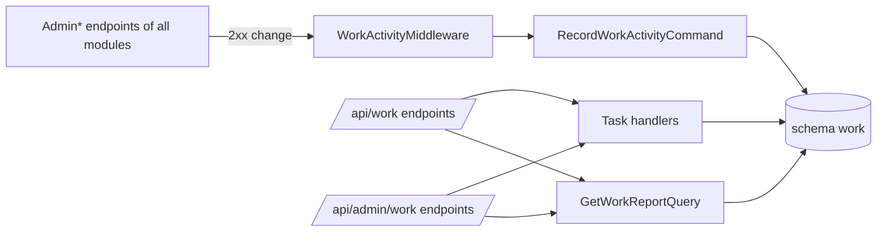

# Staff tasks and the activity log

**Static code check:** 2026-11-14. **Module:** Work. **Spec:** [work/001](../../specs/work/001-staff-tasks-and-activity/README.md).

Every staff member (Manager, Seo, Admin) keeps an own board «Мої задачі» with the columns «План», «В роботі», «Готово» and writes what was done when a task is finished. An administrator can put a task on anybody's board and reads a person's report for a period: finished tasks with their results, open tasks, and what the person changed in the admin. The change list is written automatically, so nobody fills it in.

## Structure and relationships

The Minimal API endpoints in [TasksEndpoints](../../../../src/Work/Work.Api/Endpoints/Tasks/TasksEndpoints.cs) and [ReportEndpoints](../../../../src/Work/Work.Api/Endpoints/Report/ReportEndpoints.cs) map two groups. `/api/work` (`RequireManagerRole`, tag `WorkTasks`) works only with the caller's own tasks and report: [OwnWorkTask](../../../../src/Work/Work.Application/Features/Tasks/Shared/OwnWorkTask.cs) answers `404` for another person's task. `/api/admin/work` (`RequireAdminRole`, tag `AdminWork`) creates a task for a user and reads anybody's report. Each use case has its own `<UseCase>Endpoint.cs` and HTTP request record next to it. [WorkTask](../../../../src/Work/Work.Domain/Tasks/WorkTask.cs) keeps the state rules (start time once, result only while done), up to 30 [steps](../../../../src/Work/Work.Domain/Tasks/WorkTaskStep.cs) in a jsonb column and an optional due date; `isOverdue` is computed for the Kyiv day by [WorkCalendar](../../../../src/Work/Work.Application/Features/Tasks/Shared/WorkCalendar.cs).

[WorkActivityMiddleware](../../../../src/Work/Work.Api/Endpoints/Activity/WorkActivityMiddleware.cs) runs after authorization (`UseWorkActivity()` in [WorkModule](../../../../src/Work/Work.Api/DependencyInjection/WorkModule.cs)). After a staff member's `2xx` answer to `POST`, `PUT`, `PATCH` or `DELETE` on any `Admin*` endpoint group (by tag) or, until its module moves to Minimal API, `Admin*` controller of another module, it sends [RecordWorkActivityCommand](../../../../src/Work/Work.Application/Features/Activity/Commands/RecordWorkActivity/RecordWorkActivityCommand.cs) with the area (`Categories`), operation (the endpoint name such as `updateAdminMediaFolder`, or the controller action name such as `UpdateContent`), method, and route values (`id=12, lang=uk`). The handler merges a repeat of the same change within 10 minutes into the last entry ([WorkActivity](../../../../src/Work/Work.Domain/Activity/WorkActivity.cs)). Other modules do not know about Work; a failed write is only logged.

[GetWorkReportHandler](../../../../src/Work/Work.Application/Features/Report/Queries/GetWorkReport/GetWorkReportHandler.cs) counts Kyiv calendar days (period ≤ 92 days) and returns at most 2000 activity entries. Users are stored as Identity user IDs without a foreign key; the admin shows names from the users list.

## Code structure

```text
src/Work/
├── Work.Api/
│   ├── Endpoints/Tasks/                           # TasksEndpoints (groups); one <UseCase>Endpoint + request per use case
│   ├── Endpoints/Report/                          # ReportEndpoints; GetMyWorkReportEndpoint, GetWorkReportEndpoint
│   ├── Endpoints/Activity/WorkActivityMiddleware.cs  # writes the activity log after admin changes
│   └── DependencyInjection/WorkModule.cs          # AddWorkModule, MapWorkEndpoints, UseWorkActivity
├── Work.Application/
│   ├── Abstractions/Persistence/                  # IReadWorkDbContext, IWorkRepository
│   ├── Abstractions/Users/WorkViewer.cs           # signed-in staff member
│   ├── Features/Tasks/Commands/                    # CreateMyWorkTask, UpdateMyWorkTask, ChangeMyWorkTaskStatus, SetMyWorkTaskStep, DeleteMyWorkTask, CreateWorkTaskForUser
│   ├── Features/Tasks/Queries/GetMyWorkTasks/
│   ├── Features/Tasks/Shared/                     # DTO, input rules, calendar, status names
│   ├── Features/Activity/Commands/RecordWorkActivity/  # middleware only
│   └── Features/Report/Queries/GetWorkReport/     # report for a user and a period
├── Work.Contracts/                                # empty until another module needs Work
├── Work.Domain/                                   # WorkTask, WorkActivity, errors
└── Work.Infrastructure/
    ├── Persistence/WorkDbContext.cs               # schema work, own migration history
    ├── Persistence/{Tasks,Activity}/*Configuration.cs
    ├── DependencyInjection/WorkInfrastructure.cs  # AddWorkInfrastructure
    └── Migrations/*_InitialWork.cs, *_WorkTaskStepsAndDueDate.cs
```

## Structure diagram



## Data

[Work: tasks and activity](../../architecture/data-model/work-tasks.md). Contract: [work.openapi.yaml](../../contracts/work/work.openapi.yaml).

## Tests

- Unit: [WorkTaskTests](../../../../tests/UnitTests/Work/WorkTaskTests.cs), [WorkActivityTests](../../../../tests/UnitTests/Work/WorkActivityTests.cs), [WorkValidatorTests](../../../../tests/UnitTests/Work/WorkValidatorTests.cs) — `dotnet test tests/UnitTests/UnitTests.csproj --filter "FullyQualifiedName~UnitTests.Work"`.
- API: [WorkApiTests](../../../../tests/IntegrationTests/Work/WorkApiTests.cs) (in-memory, no Docker) — `dotnet test tests/IntegrationTests/IntegrationTests.csproj --filter "FullyQualifiedName~IntegrationTests.Work"`.
