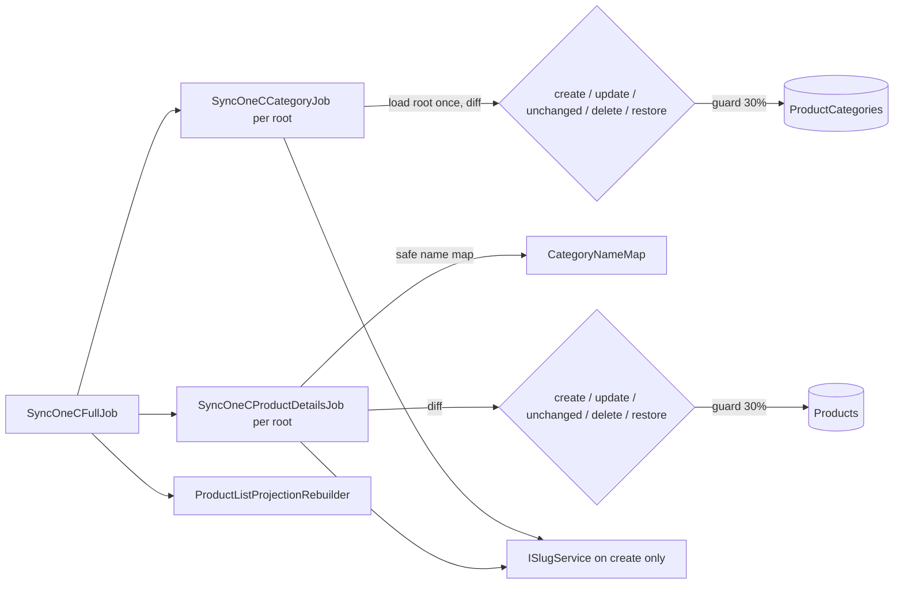

# 005 — Design

Requirements and scenarios: [README](README.md).

## Data model

All tables live in the Catalog schema owned by `CatalogDbContext`; read the [database map](../../../architecture/data-model/README.md) before changing names.

| Table | Change | Key and integrity |
| --- | --- | --- |
| `Products` | existing `IsDeleted` (already filtered by `HasQueryFilter`) starts being used; add `DeletedAt timestamptz null`; `ProductSlug` gets a unique index | unique `ProductSlug` |
| `ProductCategories` | add `IsDeleted bool not null default false`, `DeletedAt timestamptz null`, `UpdatedAt timestamptz null`; add query filter `!IsDeleted`; `Slug` gets a unique index | unique `Slug` |
| `CatalogSlugHistory` (new) | old slugs of products and categories | PK (`EntityType smallint`, `Slug varchar(255)`); `EntityId int not null`; `ChangedAt timestamptz`; index (`EntityType`, `EntityId`) |
| `CategoryContents` (new) | content per category and language | PK (`CategoryId`, `Language char(2)`); FK → `ProductCategories` (restrict); `SeoTitle`, `MetaDescription`, `H1`, `BodyHtml`, `UpdatedAt`, `UpdatedBy` (Identity user ID string) |
| `CategoryFaqItems` (new) | ordered FAQ of one content row | PK `Id bigint identity`; FK (`CategoryId`, `Language`) → `CategoryContents` cascade; `SortOrder`, `Question`, `Answer`; index (`CategoryId`, `Language`, `SortOrder`), not unique, so a full replace can delete and insert in one save |

IDs follow the [ID strategy](../../../standards/identifier-strategy.md): history and content use natural composite keys; FAQ items are an ordinary owned list with a `long` identity. Products and categories keep their 1C `int` IDs.

Uniqueness across current slugs and history (R-008, R-009) is enforced in the application by the slug service, which reads both sets inside the same transaction as the write; the unique indexes on each table protect against races.

### Domain

- `ProductCategory` gains `IsDeleted`, `DeletedAt`, `UpdatedAt`, `MarkDeleted(now)`, `Restore(now)`, `ChangeSlug(newSlug)` and `UpdateFromOneC(...)` returning whether anything changed. `Update(name, slug, …)` no longer accepts a slug from the import.
- `Product` gains `DeletedAt`, `MarkDeleted(now)`, `Restore(now)`, `ChangeSlug(newSlug)`; `Update(...)` from the import drops the slug parameter and returns whether 1C-owned fields changed.
- `CategoryContent` aggregate (category + language) owns its FAQ items and enforces R-012 limits; HTML sanitizing is an Application service so Domain stays free of the library.
- `SlugHistoryEntry` entity; `CatalogEntityType` enum (`Product = 1`, `Category = 2`).

### Slug service

`ISlugService` in Application:

- `Generate(name, entityType)` → transliterate (`UkrainianTransliterator`, pure static class, KMU 2010 table incl. word-initial `є ї й ю я` forms and `зг` → `zgh`), normalize, cut, then reserve a unique candidate against current slugs + history.
- `ChangeAsync(entityType, entityId, newSlug)` → validate, write the old slug to history, set the new one.
- `ResolveAsync(entityType, slug)` → current entity ID for a current or historical slug.

## HTTP contract

Public routes keep their paths and operation IDs; changes are additive. Contract sources: [category reads](../../../contracts/catalog/category-read.openapi.yaml), [products](../../../contracts/catalog/products.openapi.yaml), [aggregated](../../../contracts/openapi.yaml).

| Route | Change |
| --- | --- |
| `GET /api/catalog/{lang}/categories` (`getCategoryTree`) | node `+productCount`; omit deleted and empty nodes |
| `GET /api/catalog/{lang}/categories/by-slug/{categorySlug}` (`getCategoryBySlug`) | accepts historical slug (response `slug` = current); `404` + optional `CatalogRedirect` body for deleted; `+productCount`, `+minPrice`, `+maxPrice`, children `+productCount`, `+content` (`CategoryContent` or `null`) |
| `GET /api/catalog/{lang}/products`, `…/{categorySlug}/products` | `+availability` (`inStock` \| `all`), sort `+AvailabilityThenName`; unknown/deleted category → `404` |
| `GET /api/catalog/{lang}/product/{productSlug}` | accepts historical slug (response `productSlug` = current); `404` + `CatalogRedirect` for deleted product; `+updatedAt` |

`CatalogRedirect`: `{ redirectSlug: string, redirectType: "category" }`. `CategoryContent`: `{ seoTitle?, metaDescription?, h1?, bodyHtml?, faq: [{ question, answer }], updatedAt }`.

New Admin routes:

| Route | Access | Purpose |
| --- | --- | --- |
| `PUT /api/admin/products/{id}/slug` | `RequireAdminRole` | body `{ slug }` or `{ regenerate: true }`; `200` with new slug; `400` field errors; `404` |
| `PUT /api/categories/{id}/slug` | `RequireAdminRole` | same for categories |
| `GET /api/categories/{id}/content` | `CanManageProducts` | both languages with FAQ, `updatedAt`, `updatedBy` |
| `PUT /api/categories/{id}/content/{lang}` | `RequireAdminRole` | full replace of one language incl. FAQ; empty body fields clear them; `200` returns the sanitized result |
| `GET /api/admin/products?deleted=true`, `GET /api/categories?deleted=true` | filter honored only for Admin; for Manager `403` | deleted rows with `deletedAt` |
| Admin product list rows and Admin category rows | `+isDeleted`, `+deletedAt` | |

Idempotency: `PUT` endpoints are full replacements and safe to repeat. Errors follow the shared [API rules](../../../standards/README.md). The admin UI in kedr-web must run `npm run contracts:sync` after the contract merge.

## Import flow

`CategoryNameMap` builds `name → ids` for active categories of the root; a name with one ID maps, a name with zero or several IDs is reported as missing/ambiguous (R-023). The projection rebuild already reads products through the query filter, so deleted products drop out of the projection; it also skips products whose category is deleted.

## Planned file map

`E` existing, `C` changed, `N` new.

| Path | Role | State |
| --- | --- | --- |
| `src/Catalog/Catalog.Domain/Entities/ProductCategory.cs` | soft delete, slug change, change-detecting import update | C |
| `src/Catalog/Catalog.Domain/Entities/Product.cs` | `DeletedAt`, restore, slug change, change-detecting import update | C |
| `src/Catalog/Catalog.Domain/Entities/CategoryContent.cs`, `CategoryFaqItem.cs` | content aggregate and limits | N |
| `src/Catalog/Catalog.Domain/Entities/SlugHistoryEntry.cs`, `ValueObjects/CatalogEntityType.cs` | slug history | N |
| `src/Catalog/Catalog.Application/Slugs/UkrainianTransliterator.cs` | KMU 2010 transliteration | N |
| `src/Catalog/Catalog.Application/Slugs/SlugText.cs`, `SlugAllocator.cs` | normalize, cut, suffix; unique allocation in a run | N |
| `src/Catalog/Catalog.Application/Slugs/SlugService.cs` (+ `ISlugService`) | allocator load, resolve, taken check, history write | N |
| `src/Catalog/Catalog.Application/Jobs/Slugs/MigrateLegacySlugsJob.cs` | one-off `migrate-slugs` | N |
| `src/Catalog/Catalog.Application/Integrations/OneC/Sync/MassDeletionGuard.cs`, `ImportCounters.cs` | 30% guard; per-phase counters and timing (the diff itself stays in each job, one loop per entity type) | N |
| `src/Catalog/Catalog.Application/Integrations/OneC/Sync/CategoryNameMap.cs` | safe name → category mapping | N |
| `src/Catalog/Catalog.Application/Integrations/OneC/Jobs/SyncOneCCategoryJob.cs` | uses diff/slug service; manual-group hierarchy moves to `Sync/ManualCategoryHierarchy.cs` (split: the job currently holds both the import flow and the grouping algorithm) | C + N |
| `src/Catalog/Catalog.Application/Integrations/OneC/Jobs/SyncOneCProductDetailsJob.cs` | uses diff/name map; translation upsert moves to `Sync/ProductTranslationImporter.cs` (split: same reason) | C + N |
| `src/Catalog/Catalog.Application/Integrations/OneC/Mappers/CatalogMapper.cs` | drops slug generation and name lookup | C |
| `src/Catalog/Catalog.Application/Features/Category/Content/{Get,Save}/` | Admin content query and command (+ validator) | N |
| `src/Catalog/Catalog.Application/Features/Slugs/Change/` | one Admin slug command for both entity types (+ validator); updates projection rows after save | N |
| `src/Catalog/Catalog.Application/Features/Category/CategoryProductStats.cs` | counts and price range from the projection, rolled up by path | N |
| `src/Catalog/Catalog.Application/Features/Products/GetAdminList/DeletedAdminProducts.cs` | Admin-only deleted list | N |
| `src/Catalog/Catalog.Contracts/Category/CatalogRedirect.cs`, `Catalog.Contracts/Slugs/SlugDtos.cs` | redirect body and lookup result; slug DTOs | N |
| `src/Catalog/Catalog.Application/Features/Category/GetList/GetCategoriesQuryHandler.cs` | counts and hiding | C |
| `src/Catalog/Catalog.Application/Features/Category/GetBySlug/GetCategoryBySlugQueryHandler.cs` | history, redirect, counts, prices, content | C |
| `src/Catalog/Catalog.Application/Features/Products/GetPublicList/GetPublicProductListQueryHandler.cs` | `availability`, new sort, `404`; category-tree resolution moves to `Features/Category/CategoryTreeIds.cs` (shared with the tree counts) | C + N |
| `src/Catalog/Catalog.Application/Features/Products/GetBySlug/GetProductBySlugQueryHandler.cs` | history, redirect, `updatedAt` | C |
| `src/Catalog/Catalog.Application/Contracts/Content/IHtmlSanitizerService.cs` | port for HTML allow-list | N |
| `src/Catalog/Catalog.Infrastructure/Content/HtmlSanitizerService.cs` | `HtmlSanitizer` (Ganss.Xss) adapter | N |
| `src/Catalog/Catalog.Infrastructure/Configurations/{CategoryContent,CategoryFaqItem,SlugHistoryEntry}Configuration.cs` | EF mapping | N |
| `src/Catalog/Catalog.Infrastructure/Configurations/{Product,ProductCategory}Configuration.cs` | new columns, filters, unique indexes | C |
| `src/Catalog/Catalog.Infrastructure/Migrations/20261030181626_StableSlugsSoftDeleteCategoryContent.cs` | schema, including unique slug indexes | N |
| `src/Catalog/Catalog.Infrastructure/Projections/ProductListProjectionRebuilder.cs` | skip products of deleted categories | C |
| `src/Catalog/Catalog.Api/Controllers/AdminCategoriesController.cs`, `AdminProductsController.cs` | slug, content, deleted filter endpoints | C |
| `src/Catalog/Catalog.Contracts/Category/*`, `Products/*` | DTO additions | C |
| `docs/sdd/contracts/catalog/*.openapi.yaml`, `openapi.yaml` | contract | C |
| `docs/sdd/features/catalog/{categories,public-products,one-c-import,admin-products}.md` | feature cards | C |
| `tests/UnitTests/Catalog/Slugs/*`, `…/Sync/*`, `…/Domain/CatalogSoftDeleteAndContentTests.cs` | unit tests | N |
| `tests/IntegrationTests/Catalog/Import/*`, `…/Api/CatalogStableUrlsApiTests.cs` | import and API tests on an in-memory database | N |

## Rollout and rollback

1. **Migration** (run by `Host.Jobs --job=migrate` as today) adds columns, tables, and the unique slug indexes. Legacy slugs end with the unique 1C ID, so existing rows already satisfy the indexes; one migration is enough.
2. **Slug data step**: a one-off, idempotent `Host.Jobs --job=migrate-slugs` regenerates every legacy slug (one that ends with `-<1C id>`) in ID order (deterministic collision suffixes) with the same C# generator the import uses, and writes each previous slug to `CatalogSlugHistory`. Legacy slugs stay reserved during allocation, so no new slug can take one. A rerun finds no legacy slugs and changes nothing.
3. **Deploy API** with redirect-aware reads. Old clients keep working: old slugs resolve through history.
4. **Run the import** once and check the new counters.
5. **Rollback:** the API can be rolled back to the previous version as long as the old slug columns hold the new values (old API serves new slugs and does not know history, so old slugs then return `404`/empty). The schema migration is additive; a down migration drops the new tables and columns. Restoring the old slug values requires the history table, so it must not be dropped before a decision.

Operations docs to update: [migrations and seeding](../../../operations/data/migrations-and-seeding.md) and the [Host.Jobs CLI](../../../operations/jobs/host-jobs-cli.md).

## Risks

- **Search engines and old links** see new URLs on the new site; old ones redirect through history (site step). The old Angular storefront receives new slugs in lists after the migration, which is fine because it reads them from the API.
- **2-hour product import:** this change removes DB-side waste; if the 1C SOAP call dominates, the timings from R-024 will show it.
- **HTML from Admin** is stored only after sanitizing; the site still renders it as trusted HTML only from this field.
